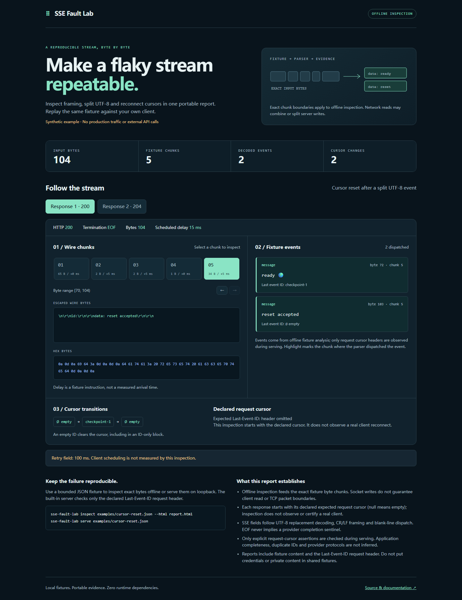

# SSE Fault Lab

[](https://github.com/7364588/sse-fault-lab/actions/workflows/tests.yml)

**Turn a streaming bug into a shareable fixture.** Inspect exact SSE byte chunks,
then replay the fixture on localhost and check the client's `Last-Event-ID`
headers. No model provider, API keys, outbound requests or runtime dependencies.
Node.js 22 and 24 are tested targets.

[Explore the synthetic report](https://7364588.github.io/sse-fault-lab/)
· [Releases](https://github.com/7364588/sse-fault-lab/releases)



## Why this exists

Small protocol details cause real failures: an [empty ID did not clear a stale
resume token](https://github.com/modelcontextprotocol/typescript-sdk/issues/2769),
[UTF-8 characters broke across byte chunks](https://github.com/Effect-TS/effect/issues/6039),
and [a clean EOF followed a different recovery path from a transport error](https://github.com/langchain-ai/langgraph/issues/9016).
The UTF-8 issue has a merged fix; these links explain the regression cases, not
claims that every current version remains broken. Application terminal events
and reconnect policies can differ from the generic SSE standard.

SSE Fault Lab packages those cases as plain JSON, an offline timeline, and one
small HTTP fixture server. It does not run a provider simulator or evaluate
models. [WireMock](https://wiremock.org/docs/simulating-faults/) already provides
general network faults, [Tyk's mock server](https://github.com/TykTechnologies/tyk-mock-mcp-server)
provides SSE crash endpoints, and [eventsource-parser](https://github.com/rexxars/eventsource-parser)
is an established parser building block. This project's focus is a portable
fixture and explicit cursor evidence in a single workflow.

## Install

Initial alpha, distributed through GitHub. This project is **not published to the
npm registry**. Install the release artifact:

```sh
npm install --global https://github.com/7364588/sse-fault-lab/releases/download/v0.1.0/sse-fault-lab-0.1.0.tgz --ignore-scripts
sse-fault-lab --help
```

Or clone the repository:

```sh
npm ci --ignore-scripts
npm run build
node dist/cli.js inspect examples/cursor-reset.json --html cursor-report.html
```

The tarball includes `dist`; installation does not require lifecycle scripts or
a compiler. Do not substitute an unverified registry package with the same name.

## Reproduce a problem

```sh
# Validate structure and bounds, without opening a listener.
sse-fault-lab validate examples/cursor-reset.json

# Feed the exact fixture chunks to the offline parser.
sse-fault-lab inspect examples/cursor-reset.json --json
sse-fault-lab inspect examples/cursor-reset.json --html inspected.html

# Start one bounded logical-client sequence on a random loopback port.
sse-fault-lab serve examples/cursor-reset.json --timeout-ms 15000 --output served.json --html served.html
```

`serve` prints the `/events` URL and an origin URL. Open the origin in a browser
and press **Connect once** to use native `EventSource`, or point your own client
at `/events`. The built-in page lists default message events; named events remain
in the fixture and report. This is a single-client test server: overlapping
requests fail clearly. Restart it for each test run.

Only `GET /events` advances the fixture. `GET /` is the constant test page.
Unknown routes, other methods and cross-origin requests do not consume steps.
The server binds `127.0.0.1`, checks Host/Origin, sends no wildcard CORS header,
and automatically closes after the final scripted response or the timeout.
It is a development tool, not an internet-facing service.

## Fixture format

```json
{
  "format": "sse-fault-lab/v1",
  "name": "Clear a resume cursor",
  "connections": [
    {
      "expectedLastEventId": null,
      "status": 200,
      "chunks": [
        {"text": "retry: 100\nid: checkpoint\ndata: first\n\n", "delayMs": 0},
        {"text": "id:\n\ndata: reset\n\n", "delayMs": 10}
      ],
      "end": "eof"
    },
    {"expectedLastEventId": null, "status": 204, "chunks": [], "end": "eof"}
  ]
}
```

Unknown fields are errors. Each chunk contains exactly one `text` or canonical
padded `base64` field; `base64` can represent partial or intentionally invalid
UTF-8. Optional `delayMs` waits before that chunk; its default is zero. Input
JSON uses UTF-8. Names and text must contain valid Unicode scalar sequences.

`expectedLastEventId` is required. `null` requires an absent request header;
`""` requires an explicitly empty header; a nonempty string requires an exact
UTF-8 value. Native EventSource omits the header after an empty-ID reset, so the
usual reset assertion is `null`. Header values are bounded to 256 UTF-8 bytes
and cannot contain control characters. Duplicate or malformed cursor headers
fail the assertion.

`status` is `200` or `204`; a `204` step has no chunks and uses `end: "eof"`.
`eof` completes a valid HTTP response. `disconnect` destroys the response
transport after writing the configured bytes, without a complete chunked HTTP
ending. It does **not** promise a particular TCP reset flag or client error text.
The fixtures have no includes, URLs, arbitrary headers, code hooks or commands.

**Server writes are not client reads.** TCP, HTTP and client buffering can merge
or split bytes. Offline inspection and the `SseParser.feed` API are the places
to test exact chunk boundaries; the HTTP server tests timing, termination and
request behavior. A completed server run means the listed requests matched,
not that a client will never reconnect again after the server has stopped.

## Inspection and reports

The offline reference parser implements the framing and field rules in the
[WHATWG SSE section](https://html.spec.whatwg.org/multipage/server-sent-events.html):
UTF-8 replacement decoding, one initial BOM, CRLF/CR/LF, repeated `data`, comments,
named events, ID inheritance/reset, ignored NUL IDs and ASCII-digit `retry`.
ID-only blank-line blocks can commit a cursor without dispatching a data event.
EOF discards unfinished lines/blocks; `[DONE]` has no special meaning here.

Each response in inspection starts with the cursor declared by its expected
request header. These are independent fixture assertions, not inferred reconnect
requests. `retry` decimal digits are preserved as text to avoid rounding large
integers; the tool never schedules reconnections from them. A real client decides
when to reconnect. Byte offsets are zero-based exclusive consumed boundaries;
a CRLF terminator is recognized at CR, even if LF arrives in the next chunk.

Reports include per-connection events, fields, cursor transitions, retry
observations, byte ranges and previews. A chunk preview is limited to its first
256 bytes and explicitly marked when truncated. Full event data remains in the
bounded report. Serve reports add the observed cursor and assertion result to
the same fixture timeline; this does not capture what the client decoded.

HTML reports are standalone and contain no external assets. Reports contain
fixture text and explicitly relevant `Last-Event-ID` values. Do not put private
data in shared fixtures. Authorization, cookies, request bodies and arbitrary
headers are never recorded. Existing report paths are never overwritten;
publication uses a temporary file and an atomic hard link. Filesystems without
hard-link support cannot publish reports. If writing two report formats, each
file is published independently.

| Exit | Meaning |
| --- | --- |
| `0` | Validated, inspected, or completed all scripted requests successfully |
| `1` | Cursor assertion, timeout, client interruption, or another incomplete run |
| `2` | Invalid input, usage, I/O, or resource-limit error |

`--json` emits one object for validate/inspect. Serving emits a `ready` record
then a `result` record; `--output` writes the final report without the wrapper.
Inspection success is not a full client-compliance or application-completeness
verdict. There is no HTTP/2, TLS, proxy certification, live capture, remote replay,
full MCP simulation, provider completion policy, or performance benchmark.

## Library

```js
import {readFileSync} from 'node:fs';
import {inspectScenario, createScenarioServer, SseParser} from 'sse-fault-lab';

const scenario = JSON.parse(readFileSync('scenario.json', 'utf8'));
const report = inspectScenario(scenario);

const server = await createScenarioServer(scenario, {port: 0, timeoutMs: 10000});
try {
  console.log(server.url); // Point one test client here.
  const result = await server.done;
  console.log(result.outcome);
} finally {
  await server.close(); // Idempotent; also resolves done on early shutdown.
}

const parser = new SseParser({initialLastEventId: ''});
parser.feed(Buffer.from('data: hello\n\n'), 0);
console.log(parser.finish().events);
```

`validateScenario` returns a normalized copy. `parseScenario` accepts bounded
JSON text. `inspectScenario` returns `sse-fault-lab/report/v1`; `request` is null
until serving observes a request. `server.snapshot()` returns a copy. Parser
results expose fields and event data; after a resource error discard the parser.
`finish()` is idempotent and further `feed()` calls are rejected.

## Bounds and development

| Bound | Limit |
| --- | --- |
| JSON file / decoded fixture bytes | 2 MiB / 1 MiB |
| Connections / chunks | 32 / 2,048 total |
| Delay per chunk / total scripted delay | 10 s / 60 s |
| Server lifetime | 50 ms–120 s; default 15 s |
| Line bytes / accumulated event characters | 64 KiB / 262,144 |
| Report observations / dispatched events | 8,192 / 4,096 |
| Serialized observation characters, across all responses | 4 MiB |
| Incoming HTTP header block / cursor | 4 KiB / 256 UTF-8 bytes |
| Incoming requests / concurrent sockets | 128 / 16 |

All observation categories share the report cap. Resource limits intentionally
reject some otherwise valid large streams. Increase the server timeout explicitly
when using slow fixtures. A malformed UTF-8 sequence becomes U+FFFD according to
the standard; it is not a validation error by itself.

```sh
npm ci --ignore-scripts
npm run build
npm test
npm run smoke
npm run demo
npm pack --ignore-scripts
```

Tests cover exact byte boundaries and real loopback HTTP behavior. CI targets
Node 22/24 on Linux plus Node 24 on Windows and macOS. The demo uses only
synthetic fixture data. See [CONTRIBUTING](CONTRIBUTING.md),
[SECURITY](SECURITY.md) and [CHANGELOG](CHANGELOG.md).
